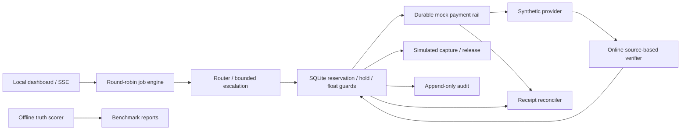

# Touchstone

Quality-aware inference procurement for autonomous agents. A customer approves a job budget; Touchstone allocates scarce operator float, purchases calls, checks results, and records what every attempt actually cost.

Built for the Airwallex Agentic Banking Hackathon, extending Kit 12 with quality checks and payment recovery. **A real Metal testnet inference purchase is proven. Airwallex authentication/reads pass; direct PaymentIntent creation is blocked by merchant configuration. A hosted-checkout fallback is implemented but not yet exercised.** The three-job financial scenario remains simulated.

## Run it

Python 3.11+; no runtime dependencies. Tested on Windows with Python 3.12.

```powershell
python -m touchstone serve
```

Open **http://127.0.0.1:8088** and select **Run three-job demo**. Three simulated customer holds total $2.50 against $1.50 in operator float. Watch prices, latency and quality change, a prompt expand, and jobs pause within policy. Close unfinished jobs to capture their actual simulated cost and release unused authorization. Resume preserves every existing limit.

```powershell
python -m unittest discover -s tests -v
python -m touchstone benchmark
python -m touchstone demo --data-dir data/cli-demo
```

Benchmark results are saved to [bench/results/RESULTS.md](bench/results/RESULTS.md) and `simulated.json`. The demo command emits JSON; the server provides the visual dashboard and SSE stream. A policy pause is an expected result of the short-float scenario, not permission to raise a limit.

## What works today

- SQLite WAL accounting with integer micro-USD, atomic reservations, hold limits, per-call caps, provider allowlists, mandate expiry and shared-float allocation.
- Three provider simulators, expiring price offers, observed-check routing and bounded escalation.
- Independent durable mock payment receipts, receipt matching, idempotency conflicts and recovery before new purchases.
- Source-based invoice and arithmetic checks; a cited invoice-to-purchase-order/payment cross-check that recomputes totals and always pauses for human review.
- Separate offline truth scoring, paired three-policy evaluation over five seeds, and explicit synthetic latency estimates.
- Simulated authorization, capture once, release unused hold, partial closure, kill switch and operator resume.
- Append-only audit events with hash chaining; responsive dashboard with mode disclosures.
- A recoverable Airwallex sandbox hold/capture workflow, a Metal SDK adapter, and reproducible local-model setup/profiling tools.

## What is simulated, measured, or unfinished

| Component | Current mode | Evidence / limit |
|---|---|---|
| Ledger and control logic | Real local code | Concurrency and process-death tests |
| Airwallex holds/capture | Integrated adapter implemented; external blocker | PaymentIntent creation returns merchant `configuration_error`; no completed authorization/capture |
| Airwallex connectivity | Verified sandbox authentication and reads | Balance and Global Account reads passed after scope update |
| Metal and x402 | Real funded testnet proof | 0.10 USDZ deposit, one 0.01 USDZ paid inference, signed receipt and original-delivery replay |
| Inference | SIMULATED | Synthetic reliability and latency; no model runs in the dashboard |
| Local GPU profiling | Measured on RTX 3050 | Two Qwen model sizes, 90 paired calls each; raw results and hardware telemetry saved separately |
| Benchmark | Simulator only | Not evidence of model savings or real-world quality |
| Agent planning | Deterministic | No live LLM planner or reference judge |
| Approval increases | Not implemented | Pause or close; no silent cap/float increase |
| Refunds | Not implemented | Failed calls remain charged |

**The accurate pitch:** spend autonomously within an approved mandate, verify what can be checked, stop or escalate on uncertainty, and account for every paid attempt. Payment precedes verification; this system does not promise payment only for correct output.

## Architecture



Python owns the control plane and SQLite ledger. The standalone Metal adapter uses Node 22.13+ and the supported SDK for signing, clearing payments and recovery.

The SDK adapter is in `integrations/metal/`, with pinned dependencies, a lockfile and a Windows-compatible SQLite wallet. The separate `banked-job` orchestrator connects it to sandbox authorization/capture and a durable job journal. It requires an explicit integration-probe purpose; measured models remain ineligible for autonomous purchases. The original multi-job simulator retains `MockRail`.

See [live proof and the Airwallex blocker](docs/LIVE_PROOF.md). The real model returned 1250 cents where the correct answer was 2000; the verifier rejected it, and the paid failure remains charged. Both a buyer-cache retry and a provider receipt replay returned the original result without another payment.

## Connect your accounts

Follow [the account setup guide](docs/ACCOUNT_SETUP.md). Start with:

```powershell
python -m touchstone doctor
python tools/metal.py inspect
```

The first prints configuration flags only. The second reads public testnet deployment metadata and sends no payment. Once your sandbox credentials are set, `airwallex-hold` tests one authorization/capture cycle using a fixed test card and an immutable operation scope. `--recover` retrieves an interrupted operation before allowing another write.

The updated `source-rules-v2` simulator benchmark reports 100% median accepted-and-correct outcomes at $6.162 for Touchstone, versus 99.5% at $10.200 for premium. These templates fall within the verifier's explicit source rules; this is not general semantic accuracy or measured GPU savings. The original 86% membership-only baseline remains in `bench/results/baseline-v1/`.

Two real local tiers have also been profiled on the RTX 3050 using schema-constrained output and explicit NVIDIA Vulkan device selection. Qwen2.5 0.5B Q4_K_M achieved 22.2% strict correctness; 1.5B Q4_K_M achieved 48.9% across 90 calls each. The measured-output replay shows that blindly trying economy and then escalating is less cost-effective than starting with balanced at the assumed prices. Neither tier is approved for autonomous paid work from this evidence. See [local results](bench/results/LOCAL_RESULTS.md).

Reproduce the local experiment:

```powershell
python tools/setup_local.py --tier economy
python tools/setup_local.py --tier balanced
python tools/profile_local.py --tier economy
python tools/profile_local.py --tier balanced
python tools/replay_profiles.py
```

Profiles use three paired seeds, discard one warm-up per model, and record actual HTTP call latency, model hashes, runtime version and GPU telemetry. Replay costs are assumed procurement prices; no financial payment is made. The main dashboard still uses simulated inference.

## Integration commands

Set sandbox keys **in your shell**, never in chat or tracked files. `.env.example` is documentation and is not auto-loaded.

The CLI also loads ignored `data/local-config.json` and an optional locally generated `data/metal/funding-wallet.json`. Process environment takes precedence. Existing local credentials are already configured in this workspace. Restart long-running processes after changing configuration values.

```powershell
$env:AIRWALLEX_CLIENT_ID = '<sandbox-client-id>'
$env:AIRWALLEX_API_KEY = '<sandbox-api-key>'
python -m touchstone airwallex-smoke
```

This authenticates and reads balances/accounts without printing tokens, secrets or bank details. It does not alter dashboard mode or perform funding, FX, holds or captures.

For an already-running llama.cpp/OpenAI-compatible server on loopback:

```powershell
$env:LOCAL_INFERENCE_URL = 'http://127.0.0.1:8080/v1/chat/completions'
$env:LOCAL_MODEL = '<actual-loaded-model>'
python -m touchstone profile-local --steps 30
```

The profiler discards one warm-up and records measured latency and offline correctness, with no payments. The detected GPU is an RTX 3050 Laptop, 4096 MiB VRAM, driver 610.62. Start with one small quantized model, limited context and at least 20% VRAM headroom; profile model sizes before assuming quantization creates a useful quality difference.

## Evidence and next milestones

Start the local model and testnet provider in separate terminals; these commands do not start a checkout:

```powershell
python tools/run_local.py --tier balanced
python tools/metal.py provider
python tools/prove_metal.py --withdraw-only
```

`prove_metal.py` uses one persistent protocol-probe reservation and a USD 0.01 cap; reruns preserve its original payment. The old `banked-proof-001` scope has an unresolved direct-create outcome and is for recovery only. Use a fresh scope for hosted checkout; that fallback needs a sandbox account ID, Checkout Sessions API access and an explicit customer action. `banked-job --integration-probe` then makes a separate testnet purchase and should only be run when that expense is intended. Live checking fees are zero, fractional cents are absorbed by the merchant, and gas is merchant expense. No fiat-to-token bridge is implied. See [account/integration setup](docs/ACCOUNT_SETUP.md).

The new local planner resolves bounded inputs before any model purchase. It solved **1,000/1,000 generated tasks with zero inference calls**, and handled 24 authored boundary cases as expected (6 resolved, 18 deferred for review). This demonstrates why these templates are accounting fixtures rather than evidence that paid inference is necessary. Neither measured model meets the offline eligibility screen; repeated classification messages count only once.

```powershell
python -m touchstone procurement-evidence
python -m touchstone plan
python -m touchstone plan --input path/to/tasks.json
```

The dashboard's **Planning** section lets you explore local-tool and review decisions. It is separate from the simulated payment scenario. Provider spend is zero in this experiment; CPU and review costs are not priced. See [procurement results](bench/results/PROCUREMENT_RESULTS.md) and [policy and next finance-operations experiment](docs/PROCUREMENT_POLICY.md).

- [Detailed proposal review](docs/PROPOSAL_REVIEW.md)
- [Dated build roadmap](docs/ROADMAP.md)
- [Integration contracts and sources](docs/INTEGRATIONS.md)
- [Account setup and sandbox commands](docs/ACCOUNT_SETUP.md)
- [Financial invariants and limitations](docs/LIMITATIONS.md)
- [Five-minute demo script](docs/DEMO_SCRIPT.md)
- [Validation record](docs/VALIDATION.md)
- [Actual integration evidence](docs/LIVE_PROOF.md)
- [Submission draft](docs/SUBMISSION.md)

The official event page currently lists the build phase ending **13 November 2026, 18:29 UTC / 23:59 IST** and registration ending 25 October. Confirm your accepted registration and the submission portal status. Judging criteria, license requirements and award eligibility remain unverified.

Sources: [event page](https://www.hackerearth.com/community/challenges/hackathon/agentic-banking-hackathon/), [builder guide linked by the event](https://airwallexdev.com/guide), [Airwallex sandbox documentation](https://www.airwallex.com/docs/developer-tools/sandbox-environment), [Metal clearing documentation](https://docs.metalntwx.com/agents/clearing). Reviewed 29 October 2026.
