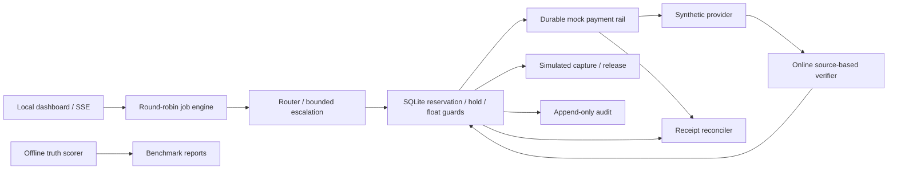

# Touchstone

The financial trust layer for autonomous agents: **pay for proof, not promises**.

Touchstone reserves an approved budget, pays the provider, checks the result and
accounts for every attempt. Payment precedes verification; rejected work can still
cost money.

### Three saved proofs

- **MEASURED testnet:** a paid answer was rejected and its original receipt/delivery
  replayed without another purchase. [Historical proof](bench/results/metal-paid-proof.json).
- **MEASURED sandbox:** one 1.00 USD → 0.89 EUR conversion settled and matched wallet
  history. [Airwallex write/read-back](bench/results/m1/live-fx-single-conversion.json).
- **MEASURED testnet:** one unified-engine purchase survived hard process death and
  repeated recovery with one receipt and no duplicate observed.
  [Recovery proof](bench/results/m2/live-single-call-final.json).

Receipts are preconfirmed; final settlement is not independently proven. The
three-job dashboard remains **SIMULATED**. Airwallex fiat and Metal USDZ are separate.

*Demo GIF placeholder — add the operator-recorded capture after final rehearsal.*

**New extensions:** signed reproducible fault receipts, guarded CardRail, controlled
signed intent, FX-aware comparison, measured GPU telemetry and immutable simulated
failed-call billing. [Implementation, evidence and limits](docs/FEATURES.md) ·
[Evidence index](docs/EVIDENCE_INDEX.md).

Built for the Airwallex Agentic Banking Hackathon, extending Kit 12 with quality checks and payment recovery. **MEASURED: sandbox FX 1.00 USD → 0.89 EUR settled and reconciled; hosted 1.00 USD authorization / 0.01 USD capture completed; one new 0.01 USDZ unified-engine purchase survived hard process death and recovery without a duplicate.** The purchased answer failed verification. Receipts remain preconfirmed, and the three-job dashboard remains SIMULATED. [Current runtime, proofs and blockers](docs/RUNNING.md).

**M3, 5 November — MEASURED on SIMULATED sources:** 180 unique invoices, fixed 120/60 template split. Tool coverage 24/180 (13.3%); both installed models measured on all 180 sources, both 0 strict-correct and ineligible. The unchanged gate refuses unsafe purchases. Useful paid inference remains BLOCKED. [Report](docs/M3_REPORT.md) · [Runbook](docs/M3_RUNBOOK.md).

**M4, 4 November — implementation complete; live gate BLOCKED:** matched four-policy runner, shared fault schedule, independent scoring, aggregate caps and environment manifests. The saved proof contains **32 MOCK purchases**, not live model measurements. Proposed seller/wallet readiness is blocked and a new paid-run approval is required. [Report](docs/M4_REPORT.md) · [Runbook](docs/M4_RUNBOOK.md).

## Run it

### Marketing landing page

The separate white landing page reuses the interactive isometric locker in its
hero. Build its existing, locked frontend with Bun:

```text
cd apps/web
bun install --frozen-lockfile
bun run build
```

From the repository root, run `python -m touchstone serve`, then open
**http://127.0.0.1:8088/site/**. The operator dashboard remains at `/` and needs
no frontend build. All marketing assets/fonts are served locally; the locker is
an illustrative SVG interaction, not a financial action.

### Operator dashboard

Python 3.11+; no runtime dependencies. Tested on Windows with Python 3.12.

Start the installed dashboard, local model and seller together (PowerShell or Bash):

```text
python tools/run_project.py
```

This performs no financial transaction or hosted inference call. The existing model
and Node setup must be installed; see [runtime setup and checks](docs/RUNNING.md).
For the credential-isolated, offline simulated dashboard (Windows, macOS or Linux;
Python 3.11+ only):

```powershell
python tools/run_mock.py
```

macOS / Linux / Git Bash equivalent:

```bash
python tools/run_mock.py
```

Open **http://127.0.0.1:8088**. The first card presents the recorded real $0.01 USDZ GPU call, incorrect answer, verifier rejection, and no-customer-capture disclosure. Then select **Run three-job demo** for the separate simulated scenario: $2.50 in synthetic customer holds against $1.50 in operator float. Watch prices, latency and quality change, a prompt expand, and jobs pause within policy. A human can approve a versioned limit increase for a policy-paused simulator job using only its existing float; this does not change a real hold or wallet.

```powershell
python -m unittest discover -s tests -v
python -m touchstone benchmark
python -m touchstone demo --data-dir data/cli-demo
```

macOS / Linux / Git Bash equivalent:

```bash
python -m unittest discover -s tests -v
python -m touchstone benchmark
python -m touchstone demo --data-dir data/cli-demo
```

Benchmark results are saved to [bench/results/RESULTS.md](bench/results/RESULTS.md) and `simulated.json`. The demo command emits JSON; the server provides the visual dashboard and SSE stream. A policy pause is an expected result of the short-float scenario, not permission to raise a limit.

## What works today

- SQLite WAL accounting with integer micro-USD, atomic reservations, hold limits, per-call caps, provider allowlists, mandate expiry and shared-float allocation.
- Three provider simulators, expiring price offers, observed-check routing and bounded escalation.
- Independent durable mock payment receipts, receipt matching, idempotency conflicts and recovery before new purchases.
- Source-based invoice and arithmetic checks; cited invoice consistency checks recompute line extensions and totals without a hidden answer map. A separate noisy spot-check has measured synthetic fault-injection false-accept rates.
- Separate offline truth scoring, paired three-policy evaluation over five seeds, and explicit synthetic latency estimates.
- Simulated authorization, capture once, release unused hold, partial closure, kill switch and operator resume.
- Append-only audit events with hash chaining; responsive dashboard with mode disclosures.
- A recoverable Airwallex sandbox hold/capture workflow, an opt-in wallet FX quote/conversion and reconciliation path, a unified simulated/Metal rail, and reproducible local-model setup/profiling tools.
- A real-only Metal engine path for local-GPU only, hosted-Claude only, or local-first verifier escalation; the dashboard's separate live-trial table fills only from saved paid runs.

## What is simulated, measured, or unfinished

Labels: **MEASURED** = execution with saved evidence (scope stated); **SIMULATED** = synthetic local model of a service; **MOCK** = controlled stand-in adapter; **BLOCKED** = not demonstrated, with the missing implementation, approval or external dependency stated. A failed live service must never fall back silently and display as live. Airwallex fiat and Metal testnet tokens are separate systems; nothing here bridges them.

| Component | Label | Current mode | Evidence / limit |
|---|---|---|---|
| Ledger and control logic | MEASURED (tests) | Real local code | Concurrency and process-death tests |
| Airwallex holds/capture | MEASURED (sandbox hosted flow) | One 1.00 USD authorization; one 0.01 capture; final SUCCEEDED | [Proof](bench/results/m1/current-hosted-card-proof.json); issuer release timing unmeasured; dashboard holds remain SIMULATED |
| Airwallex connectivity | MEASURED | Verified sandbox authentication and reads | Balance and Global Account reads passed after scope update |
| Airwallex Treasury FX | MEASURED | Sandbox conversion settled and wallet history matched | Exactly 1.00 USD debited for 0.89 EUR; [saved proof](bench/results/m1/live-fx-single-conversion.json) |
| Treasury job accounting | MEASURED / SIMULATED | Actual Airwallex entries; separate demo token account | [Job proof](bench/results/m1/live-treasury-job.json); SIMULATED USDZ demo entry cannot fund Metal |
| Metal and x402 | MEASURED | Separate real testnet probes | Historical 0.10 USDZ deposit / 0.01 purchase with replay; new 0.02 deposit / 0.01 engine purchase with hard-kill recovery |
| Unified Metal engine | MEASURED (one integration probe) | One 0.01 USDZ paid call; exit 86 after rail; same receipt recovered twice | [Proof](bench/results/m2/live-single-call-final.json); rejected answer, no duplicate observed, no final-settlement claim |
| Hosted Claude tier | BLOCKED | Adapter and real-policy routing implemented; not exercised | Direct Messages API structured output, reported token usage and conservative no-repeat behavior after uncertain paid delivery; no API call or matched trial recorded |
| Dashboard inference | SIMULATED | Simulator only | Synthetic reliability and latency; no model runs in the dashboard |
| Local GPU profiling | MEASURED | Measured on RTX 3050 | Two Qwen model sizes, 90 paired calls each; raw results and hardware telemetry saved separately |
| Benchmark | SIMULATED | Simulator only | Not evidence of model savings or real-world quality |
| Agent planning | MEASURED (deterministic, synthetic) | Deterministic | No live LLM planner or reference judge |
| M3 invoice extraction | MEASURED negative result / BLOCKED useful inference | 180 synthetic sources; both local models measured and refused | Tool coverage 24/180; 0/180 strict-correct per model; no eligible provider or paid reference |
| Mandate-limit approval (versioned, human-approved) | SIMULATED | Exists in the simulator only | Audited local mandate version; job stays paused until Resume; uses only existing simulated float |
| Real Airwallex hold increase | IMPLEMENTED (controlled adapter) / not observed live | `airwallex-hold-increase` adds a supplemental sandbox PaymentIntent, then raises the mandate | Not an in-place increment; no real sandbox supplement has been run; the dashboard simulated approval is unchanged |
| Authorized live dashboard | IMPLEMENTED (controlled adapter) / not run with spend | `serve --live` with an exact authorization phrase | One bound mandate; browser must re-enter the budget; demo/close/simulated increases disabled; customer holds simulated |
| Automatic fault receipts | IMPLEMENTED (controlled adapters) | Engine failure → signed proof → provider review → retained acknowledgement | Never a refund; no live provider acknowledgement observed |
| Funded fiat execution / card merchant payment | IMPLEMENTED (controlled adapters) / BLOCKED live | Approval + fresh comparison + funded balance + single-use journal | No funded fiat merchant, issuing write or settlement evidence; Visa integration blocked |
| Measured GPU throughput | MEASURED | 124.8 tokens/s median, RTX 3050, Qwen2.5-1.5B Q4_K_M | One model, sequential load; bounded ×1.25 markup only with a valid calibration and live samples |
| Refunds | BLOCKED | Not implemented | Failed calls remain charged |

**The accurate pitch:** spend autonomously within an approved mandate, verify what can be checked, stop or escalate on uncertainty, and account for every paid attempt. Payment precedes verification; this system does not promise payment only for correct output.

## Architecture



Python owns the control plane and SQLite ledger. `CompositeRail` unifies mock and Metal payment contracts; Metal execution is selected explicitly by provider and never silently falls back to a mock. The standalone Metal adapter uses Node 22.13+ and the supported SDK for signing, clearing payments and recovery.

The SDK adapter is in `integrations/metal/`, with pinned dependencies, a lockfile and a Windows-compatible SQLite wallet. The separate `banked-job` orchestrator connects it to sandbox authorization/capture and a durable job journal. It requires an explicit integration-probe purpose; measured models remain ineligible for autonomous purchases. The original multi-job simulator retains `MockRail`.

See [live proof and the Airwallex blocker](docs/LIVE_PROOF.md). The real model returned 1250 cents where the correct answer was 2000; the verifier rejected it, and the paid failure remains charged. Both a buyer-cache retry and a provider receipt replay returned the original result without another payment.

## Connect your accounts

Follow [the account setup guide](docs/ACCOUNT_SETUP.md). Start with:

```powershell
python -m touchstone doctor
python tools/metal.py inspect
```

macOS / Linux / Git Bash equivalent:

```bash
python -m touchstone doctor
python tools/metal.py inspect
```

The first prints configuration flags only. The second reads public testnet deployment metadata and sends no payment. Once your sandbox credentials are set, `airwallex-hold` tests one authorization/capture cycle using a fixed test card and an immutable operation scope. `--recover` retrieves an interrupted operation before allowing another write.

The updated `source-rules-v3` simulator benchmark reports policy outcomes on bounded synthetic templates plus an invoice fault-injection sweep. The prior source-derived calibration score was circular and has been removed; noisy-checker rates are not population estimates or live payment gates. These results are not general semantic accuracy or measured GPU savings. The original membership-only baseline remains in `bench/results/baseline-v1/`.

Two real local tiers have also been profiled on the RTX 3050 using schema-constrained output and explicit NVIDIA Vulkan device selection. Qwen2.5 0.5B Q4_K_M achieved 22.2% strict correctness; 1.5B Q4_K_M achieved 48.9% across 90 calls each. The measured-output replay shows that blindly trying economy and then escalating is less cost-effective than starting with balanced at the assumed prices. Neither tier is approved for autonomous paid work from this evidence. See [local results](bench/results/LOCAL_RESULTS.md).

Reproduce the local experiment:

```powershell
python tools/setup_local.py --tier economy
python tools/setup_local.py --tier balanced
python tools/profile_local.py --tier economy
python tools/profile_local.py --tier balanced
python tools/replay_profiles.py
```

macOS / Linux / Git Bash equivalent:

```bash
python tools/setup_local.py --tier economy
python tools/setup_local.py --tier balanced
python tools/profile_local.py --tier economy
python tools/profile_local.py --tier balanced
python tools/replay_profiles.py
```

Profiles use three paired seeds, discard one warm-up per model, and record actual HTTP call latency, model hashes, runtime version and GPU telemetry. Replay costs are assumed procurement prices; no financial payment is made. The three-job dashboard runner remains simulated; its separate live-trial table reads only paid engine runs.

## Integration commands

Set sandbox keys **in your shell**, never in chat or tracked files. `.env.example` is documentation and is not auto-loaded.

Every money-moving action requires both an explicit execute-style flag and written approval in chat with a stated cap. M1 guards hold, checkout, banked-job and FX commands. M2 adds Metal execution/recovery guards, a versioned dispatch barrier, process-owned workers and separate wallet orchestration. Its controlled proof is MOCK; its live gate remains BLOCKED. See [M1 evidence](docs/M1_REPORT.md), [capped FX runbook](docs/M1_RUNBOOK.md), [M2 report](docs/M2_REPORT.md) and [M2 runbook](docs/M2_RUNBOOK.md).

The CLI also loads ignored `data/local-config.json` and an optional locally generated `data/metal/funding-wallet.json`. Process environment takes precedence. Local Airwallex credentials are configured, but `AIRWALLEX_ACCOUNT_ID` is currently unset. Restart long-running processes after changing configuration values.

```powershell
$env:AIRWALLEX_CLIENT_ID = '<sandbox-client-id>'
$env:AIRWALLEX_API_KEY = '<sandbox-api-key>'
python -m touchstone airwallex-smoke
```

macOS / Linux / Git Bash equivalent:

```bash
export AIRWALLEX_CLIENT_ID='<sandbox-client-id>'
export AIRWALLEX_API_KEY='<sandbox-api-key>'
python -m touchstone airwallex-smoke
```

This authenticates and reads balances/accounts without printing tokens, secrets or bank details. It does not alter dashboard mode or perform funding, FX, holds or captures.

### Airwallex Treasury FX

Read-only wallet/conversion reports require `AIRWALLEX_ACCOUNT_ID`, **Core Resources > Balances > Read**, and **Transactional FX > Conversion > Read**. Creating a quote and conversion requires **Transactional FX > Conversion > Write**. Quotes do not settle funds; a conversion is a separate write that requires `--execute`. Each conversion is journaled before dispatch, bound to a unique request ID and quote, and looked up—not blindly resubmitted—if its outcome is unknown. See [Airwallex API key scopes](https://www.airwallex.com/docs/developer-tools/api/api-key-scopes), [conversion API](https://www.airwallex.com/docs/api/transactional_fx/conversion), [quotes API](https://www.airwallex.com/docs/api/transactional_fx/quotes), and [wallet balances](https://www.airwallex.com/docs/api/core_resources/balances/current).

```powershell
python -m touchstone airwallex-fx balances
python -m touchstone airwallex-fx quote --sell-currency USD --buy-currency EUR --sell-amount 10.00
python -m touchstone airwallex-fx convert --request-id unique-fx-2026-11-01
python -m touchstone airwallex-fx convert --request-id unique-fx-2026-11-01 --sell-currency USD --max-sell-amount 10.00 --execute
python -m touchstone airwallex-fx report --request-id unique-fx-2026-11-01
```

macOS / Linux / Git Bash equivalent:

```bash
python -m touchstone airwallex-fx balances
python -m touchstone airwallex-fx quote --sell-currency USD --buy-currency EUR --sell-amount 10.00
python -m touchstone airwallex-fx convert --request-id unique-fx-2026-11-01
python -m touchstone airwallex-fx convert --request-id unique-fx-2026-11-01 --sell-currency USD --max-sell-amount 10.00 --execute
python -m touchstone airwallex-fx report --request-id unique-fx-2026-11-01
```

`report` compares a settled conversion with both wallet balance-history entries and reports current wallet balances. FX does not fund the Metal wallet or bridge fiat and tokens. No sandbox FX write has been run in this checkout.

For an already-running llama.cpp/OpenAI-compatible server on loopback:

```powershell
$env:LOCAL_INFERENCE_URL = 'http://127.0.0.1:8080/v1/chat/completions'
$env:LOCAL_MODEL = '<actual-loaded-model>'
python -m touchstone profile-local --steps 30
```

macOS / Linux / Git Bash equivalent:

```bash
export LOCAL_INFERENCE_URL='http://127.0.0.1:8080/v1/chat/completions'
export LOCAL_MODEL='<actual-loaded-model>'
python -m touchstone profile-local --steps 30
```

The profiler discards one warm-up and records measured latency and offline correctness, with no payments. The detected GPU is an RTX 3050 Laptop, 4096 MiB VRAM, driver 610.62. Start with one small quantized model, limited context and at least 20% VRAM headroom; profile model sizes before assuming quantization creates a useful quality difference.

## Hosted Claude and real-provider policies

The optional hosted tier calls Anthropic's Messages API with structured JSON output. Set `ANTHROPIC_API_KEY` in the provider terminal only; do not put it in chat, commits, or testnet buyer configuration. `ANTHROPIC_MODEL` defaults to `claude-sonnet-5`. Readiness checks verify only that the key/model are configured, not API entitlement or billing. The worker records provider-reported token usage, but the USDZ comparison does not include Anthropic's separate API bill. Hosted delivery is at-most-once after an uncertain response: a restart will not repeat a potentially billable API request, but may leave a paid receipt without recoverable output.

Configure the local GPU endpoint as `local-gpu` on port 8092 and the hosted endpoint as `hosted-premium` on port 8093. Start the local model first (`python tools/run_local.py --tier economy`), then run one seller per terminal:

```powershell
$env:TOUCHSTONE_PROVIDER_ID = 'local-gpu'
$env:TOUCHSTONE_PROVIDER_PORT = '8092'
$env:TOUCHSTONE_PROVIDER_MODE = 'model'
$env:TOUCHSTONE_PROVIDER_PRICE_USD = '0.01'
python tools/metal.py provider
```

macOS / Linux / Git Bash equivalent:

```bash
export TOUCHSTONE_PROVIDER_ID='local-gpu'
export TOUCHSTONE_PROVIDER_PORT='8092'
export TOUCHSTONE_PROVIDER_MODE='model'
export TOUCHSTONE_PROVIDER_PRICE_USD='0.01'
python tools/metal.py provider
```

```powershell
$env:ANTHROPIC_API_KEY = '<your-api-key>'
$env:ANTHROPIC_MODEL = 'claude-sonnet-5'
$env:TOUCHSTONE_PROVIDER_ID = 'hosted-premium'
$env:TOUCHSTONE_PROVIDER_PORT = '8093'
$env:TOUCHSTONE_PROVIDER_MODE = 'anthropic'
$env:TOUCHSTONE_PROVIDER_PRICE_USD = '0.05'
python tools/metal.py provider
```

macOS / Linux / Git Bash equivalent:

```bash
export ANTHROPIC_API_KEY='<your-api-key>'
export ANTHROPIC_MODEL='claude-sonnet-5'
export TOUCHSTONE_PROVIDER_ID='hosted-premium'
export TOUCHSTONE_PROVIDER_PORT='8093'
export TOUCHSTONE_PROVIDER_MODE='anthropic'
export TOUCHSTONE_PROVIDER_PRICE_USD='0.05'
python tools/metal.py provider
```

Run a no-payment preflight first, then use three different scope IDs with identical task count, seed, provider order and price cap. Only the last three commands dispatch paid testnet calls. The `real-touchstone` ceiling allows two paid attempts per task; a 30-step cap of USD 0.05 therefore needs up to USD 3.06 testnet budget, excluding the hosted API bill.

```powershell
python -m touchstone engine-metal --scope policy-preflight --steps 30 --seed 42 --budget-usd 0.05 --price-cap-usd 0.05 --provider-url http://127.0.0.1:8092 --provider-url http://127.0.0.1:8093 --policy real-touchstone --quote-only
python -m touchstone engine-metal --scope trial-cheapest-001 --steps 30 --seed 42 --budget-usd 1.53 --price-cap-usd 0.05 --provider-url http://127.0.0.1:8092 --provider-url http://127.0.0.1:8093 --policy real-cheapest --execute
python -m touchstone engine-metal --scope trial-premium-001 --steps 30 --seed 42 --budget-usd 1.53 --price-cap-usd 0.05 --provider-url http://127.0.0.1:8092 --provider-url http://127.0.0.1:8093 --policy real-premium --execute
python -m touchstone engine-metal --scope trial-touchstone-001 --steps 30 --seed 42 --budget-usd 3.06 --price-cap-usd 0.05 --provider-url http://127.0.0.1:8092 --provider-url http://127.0.0.1:8093 --policy real-touchstone --execute
```

macOS / Linux / Git Bash equivalent:

```bash
python -m touchstone engine-metal --scope policy-preflight --steps 30 --seed 42 --budget-usd 0.05 --price-cap-usd 0.05 --provider-url http://127.0.0.1:8092 --provider-url http://127.0.0.1:8093 --policy real-touchstone --quote-only
python -m touchstone engine-metal --scope trial-cheapest-001 --steps 30 --seed 42 --budget-usd 1.53 --price-cap-usd 0.05 --provider-url http://127.0.0.1:8092 --provider-url http://127.0.0.1:8093 --policy real-cheapest --execute
python -m touchstone engine-metal --scope trial-premium-001 --steps 30 --seed 42 --budget-usd 1.53 --price-cap-usd 0.05 --provider-url http://127.0.0.1:8092 --provider-url http://127.0.0.1:8093 --policy real-premium --execute
python -m touchstone engine-metal --scope trial-touchstone-001 --steps 30 --seed 42 --budget-usd 3.06 --price-cap-usd 0.05 --provider-url http://127.0.0.1:8092 --provider-url http://127.0.0.1:8093 --policy real-touchstone --execute
```

`real-cheapest` accepts only the local GPU tier; `real-premium` accepts only hosted Claude; `real-touchstone` tries local first and escalates to hosted only after a paid verifier rejection. All reject simulator quotes. The dashboard stores a local projection by task digest, and reports USDZ provider/checking spend per verifier-accepted output, failed spend absorbed by the operator, token counts and receipt reconciliation. Customer capture is zero; no Airwallex hold is implied. Do not run these commands until the provider/API and testnet budgets are explicitly approved.

## Evidence and next milestones

Start the local model and testnet provider in separate terminals; these commands do not start a checkout:

```powershell
python tools/run_local.py --tier balanced
python tools/metal.py provider
python tools/prove_metal.py --withdraw-only --execute
```

macOS / Linux / Git Bash equivalent:

```bash
python tools/run_local.py --tier balanced
python tools/metal.py provider
python tools/prove_metal.py --withdraw-only --execute
```

`prove_metal.py` uses one persistent protocol-probe reservation and a USD 0.01 cap; reruns preserve its original payment. The old `banked-proof-001` scope has an unresolved direct-create outcome and is for recovery only. Use a fresh scope for hosted checkout; that fallback needs a sandbox account ID, Checkout Sessions API access and an explicit customer action. `banked-job --integration-probe` then makes a separate testnet purchase and should only be run when that expense is intended. Live checking fees are zero, fractional cents are absorbed by the merchant, and gas is merchant expense. No fiat-to-token bridge is implied. See [account/integration setup](docs/ACCOUNT_SETUP.md).

The unified engine's real Metal route requires a configured local provider, RPC and funded job wallet. `--execute` is mandatory to dispatch; `--recover` requires an existing scope and can run without it. `--kill-at after_rail` deliberately terminates the process after a real paid response (exit 86); rerun the exact scope/mandate with `--recover` and reconcile one receipt. This kill/restart path has only been exercised against the mock rail so far. The local provider supports `TOUCHSTONE_PROVIDER_CHAOS=outage` (503 before quote/payment) and `quality-drop` (an intentionally incorrect paid delivery). The outage mode has passed one live quote-only check with no payment; paid quality-drop and kill/restart are still unrun. Live quotes add 20% per queued request, capped by the 5-cent provider ceiling, and report latency sample count so fallback estimates are not mistaken for measured timing.

The new local planner resolves bounded inputs before any model purchase. It solved **1,000/1,000 generated tasks with zero inference calls**, and handled 24 authored boundary cases as expected (6 resolved, 18 deferred for review). This demonstrates why these templates are accounting fixtures rather than evidence that paid inference is necessary. Neither measured model meets the offline eligibility screen; repeated classification messages count only once.

```powershell
python -m touchstone procurement-evidence
python -m touchstone plan
python -m touchstone plan --input path/to/tasks.json
```

macOS / Linux / Git Bash equivalent:

```bash
python -m touchstone procurement-evidence
python -m touchstone plan
python -m touchstone plan --input path/to/tasks.json
```

The dashboard's **Planning** section lets you explore local-tool and review decisions. It is separate from the simulated payment scenario. Provider spend is zero in this experiment; CPU and review costs are not priced. See [procurement results](bench/results/PROCUREMENT_RESULTS.md) and [policy and next finance-operations experiment](docs/PROCUREMENT_POLICY.md).

- [Detailed proposal review](docs/PROPOSAL_REVIEW.md)
- [Dated build roadmap](docs/ROADMAP.md)
- [Integration contracts and sources](docs/INTEGRATIONS.md)
- [Account setup and sandbox commands](docs/ACCOUNT_SETUP.md)
- [Financial invariants and limitations](docs/LIMITATIONS.md)
- [Five-minute demo script](docs/DEMO_SCRIPT.md)
- [Validation record](docs/VALIDATION.md)
- [Actual integration evidence](docs/LIVE_PROOF.md)
- [Submission draft](docs/SUBMISSION.md)

The official event page, fetched 2 November 2026, lists the build phase ending **15 November 2026, 18:29 UTC** and the registration phase ending 25 October; earlier project notes cited 13 November. This project treats **13 November (18:29 UTC / 23:59 IST) as its internal deadline** and the portal's personal deadline as authoritative once confirmed. This repository uses the MIT License. Confirm accepted registration, judging criteria, award eligibility and submission assets in the signed-in portal. The planned recording date is 12 November; feature freeze is 11 November.

Sources: [event page](https://www.hackerearth.com/community/challenges/hackathon/agentic-banking-hackathon/), [builder guide linked by the event](https://airwallexdev.com/guide), [Airwallex sandbox documentation](https://www.airwallex.com/docs/developer-tools/sandbox-environment), [Metal clearing documentation](https://docs.metalntwx.com/agents/clearing). Reviewed 29 October 2026.
