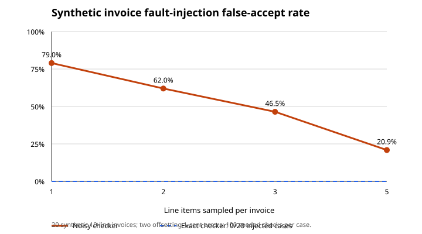

# Simulator benchmark

Synthetic provider quality and estimated latency; these are not GPU/model or live-payment measurements.

Median across seeds [41, 42, 43, 44, 45], 200 tasks per seed. Costs include failed calls and verification.

| Policy | Cost USD | True success | USD / true-correct step | Estimated p95 ms | Retries |
|---|---:|---:|---:|---:|---:|
| always-premium | 10.200 | 99.5% | 0.0513 | 360 | 0 |
| always-cheapest | 2.200 | 80.5% | 0.0137 | 980 | 0 |
| touchstone | 6.162 | 100.0% | 0.0308 | 1340 | 42 |

## Invoice verification fault injection

The exact checker independently recomputes cited quantity × unit price, line extensions and invoice total. The deliberately noisy checker samples line arithmetic but checks the aggregate. We injected two offsetting one-cent line-total errors into 20 ten-line invoices and repeated seeded sampling 100 times per case.

| Rows sampled | False accepts / 2,000 | False-accept rate | Clean accept rate |
|---:|---:|---:|---:|

| 1 | 1580 | 79.0% | 100.0% |
| 2 | 1240 | 62.0% | 100.0% |
| 3 | 929 | 46.5% | 100.0% |
| 5 | 418 | 20.9% | 100.0% |

Exact checker's false-accept rate on this injected set: 0.0%. The noisy rates are synthetic fault-injection results, not population estimates or production payment gates; noisy verification is never used to authorize a live payment.

Verifier: `source-rules-v3-invoice-consistency`. Bounded source-evidence rules check cited invoice arithmetic; unknown or ambiguous sources require review. The other synthetic templates are within their supported scope. None of these results establish semantic accuracy on arbitrary customer text.

The original membership-only baseline is retained in baseline-v1/. Its tautological calibration metric is historical and has been removed from current results. No cost or quality target was tuned to force a winning result.

Regenerate: `python -m touchstone benchmark`.
