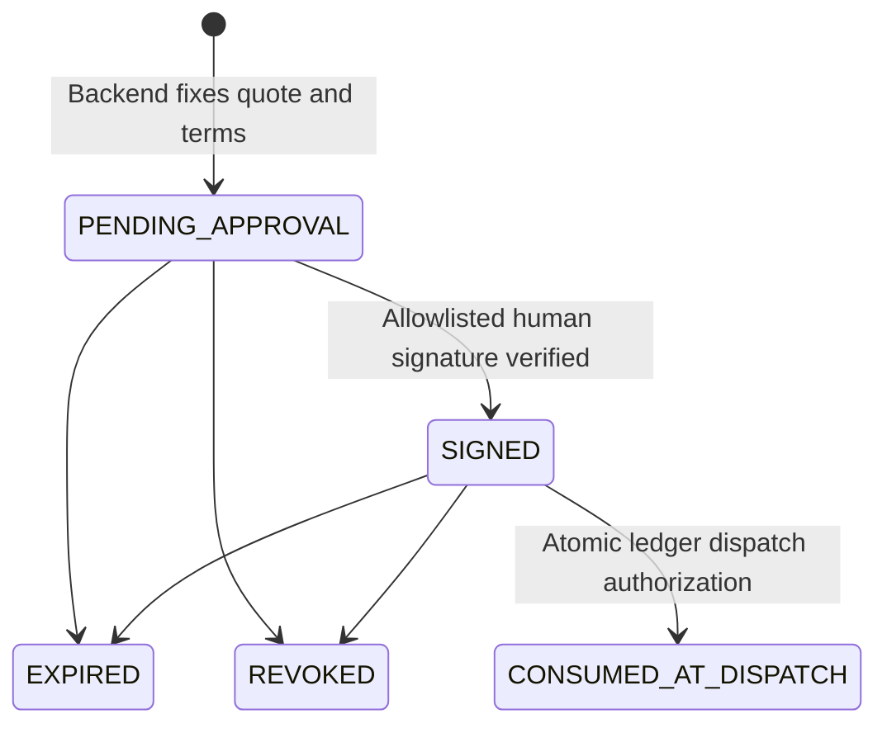

# Touchstone Signed Mandates

Cryptographic human authorization for premium inference procurement. This feature
is **implemented and validated with controlled local rails**, not live financial
evidence. No historical Airwallex or Metal transaction is relabelled human-signed.

## Protocol and trust boundary

An agent can request quotes and propose a purchase. An operator independently
allowlists a human EVM externally owned account (EOA). The human signs backend-made
EIP-712 typed data with a separate wallet. Touchstone verifies the signature using
the existing pinned viem 2.57.13; it never creates the human's key or signs an
approval with `AGENT_PRIVATE_KEY`. Contract-wallet/EIP-1271 verification is outside
this milestone.

An EOA signature proves control of a key, not physical human presence. Enrollment
and wallet policy must keep that key and signing access independent of the agent;
Touchstone cannot distinguish a human from software using a compromised approver.

The domain is `{name: "Touchstone", version: "1", chainId, salt}`. The operator's
local registry persists a random 32-byte deployment salt and the actual network.
There is **no verifying contract address**. Metal dispatch additionally checks the
RPC network is 63825. Fault receipts and TAP signatures retain their separate
protocols and do not satisfy this authorization.

EIP-712 supplies typed-data signing, not replay protection. Touchstone adds durable
nonce/purchase uniqueness and atomic state transitions. See [EIP-712](https://eips.ethereum.org/EIPS/eip-712)
and [viem's EOA verification utility](https://viem.sh/docs/utilities/verifyTypedData).

**Security limit:** the backend, signer registry, authority SQLite databases and
payment sidecar must be protected from untrusted agent writes/execution. The
current repository runs these under the same OS account. `load_local()` can load
the funding EVM key into process environment; job P-256 payment keys are stored in
`data/metal/<scope>/wallet.sqlite`. An unrestricted process with those credentials
can import the SDK, open the wallet, alter code/configuration or spend outside this
control. This feature does not protect against a compromised host, malicious
operator, registry replacement, unrestricted filesystem access or stolen payer key.
Production needs an isolated payer service/OS identity and secret store with only
the protected interface exposed. Human private keys must remain in their wallet.

## Signed schema and canonical hashes

The strict field/type contract is
[`procurement-schema.json`](../integrations/metal/procurement-schema.json).
Every field is required; extra fields, boolean/string monetary amounts, unsafe
numbers, duplicate JSON keys and malformed hashes are rejected.

| Fields | Binding |
|---|---|
| `protocol_version`, `environment`, `network`, `purpose` | Version 1, deployment/network and `PREMIUM_INFERENCE_PURCHASE` |
| `job_id`, `step_id`, `task_hash`, `purchase_key`, `attempt`, `mandate_version`, `payer_scope` | Exact public task, attempt, current mandate and paying wallet scope |
| `provider_id`, `provider_origin`, `quote_id`, `quote_digest`, `quote_expires_ms` | Provider, exact origin and immutable full quote snapshot |
| `currency`, `quoted_amount`, `max_amount` | Exact price and per-purchase cap; real Metal uses micro-USDZ |
| `budget_currency`, `job_ceiling`, `spent` | Existing ledger's nominal micro-USD accounting ceiling and usage |
| `allocation_currency`, `allocation`, `rail_spent` | Separate micro-USDZ wallet allocation/usage for real purchases |
| `api_credit_currency`, `api_credit_max` | Separate maximum prepaid USD credit exposure, in micro-USD |
| `fee_currency`, `fee_max` | Existing ledger checking-fee accounting, in micro-USD; not a measured external fee |
| `verifier_version`, `verifier_policy_digest` | Effective source-checking code hashes, task kind and quality criterion |
| `nonce`, `issued_at`, `expires_at` | Cryptographic 256-bit nonce, integer UTC seconds, at most five minutes and no later than quote/mandate expiry |

All signed monetary numbers are **integers**. USDZ provider charges, nominal ledger
micro-USD accounting, API credits and checking fees are distinct fields; their
numeric correspondence does not execute FX or bridge fiat to tokens. A signature
does not authorize deposits, top-ups, card operations, withdrawals or native fees.
Those retain their existing independent controls and approved scopes.

Task, quote, policy and terms digests use SHA-256 of **TSC1** canonical bytes:
JSON values become tagged trees (`null`, `bool`, `number`, `string`, `array`,
`object`). Objects contain code-point-sorted key/value trees. Numbers are finite
base-10 strings without exponent/trailing fractional zeroes; negative zero is
zero. Integral floats equal integral JSON numbers. Unsafe numbers, lone surrogates
and representations longer than 100 numeric characters are refused. Compact
ASCII-escaped JSON of that tree is hashed. Python and JavaScript implement the
same representation, including non-ASCII text; cross-language tests cover it.
TSC1 is a documented application encoding, not a claim of RFC 8785 compliance.

The EIP-712 signing hash uses viem's standard encoding, **not** this SHA-256 hash
as a replacement signature protocol. The signed task has no hidden truth labels.

## Durable state and crash behavior

`procurement_approvals` stores immutable canonical terms/digest, nonce, challenge
ID, expected human signer, signature, verification metadata, timestamps, consuming
purchase key and created/signed/consumed audit-event IDs. Constraints prevent
duplicate nonces and multiple active/consumed approvals for one purchase.



Displaying a proposal does not consume it. `Ledger.assert_can_pay()` rechecks the
mandate version, worker lease, halt, expiry, reservation, financial limits, exact
terms and cryptographic signature inside `BEGIN IMMEDIATE`. Approval consumption,
the purchase's `DISPATCHING` transition and audit events commit together.
Revocation/expiry release undisbursed standard-engine reservations; banked proposals
remain non-spendable workflow records. Consumed approvals cannot be revoked or
made reusable. A revocation after dispatch cannot undo a committed external call.

The Node payer independently reads only operator-allowlisted authority databases,
verifies the consumed signed record and actual wallet/provider/quote/caps, and
durably inserts a unique nonce/approval/purchase into its wallet dispatch journal
before invoking the SDK. Its wallet owner lock serializes this operation.
The ledger also issues a random one-time internal dispatch capability and stores
only its SHA-256 hash. The Node payer requires the original capability; it cannot
be reconstructed from a consumed approval or obtained through the approval API.
It is passed only on protected process stdin and never logged or exported. This
closes the gap where a caller could otherwise rebuild a dispatch envelope merely
by reading an old consumed approval. Existing worker ownership is checked again
when a lease token is present.
Changing a quote requires new approval; neither UI nor adapter silently rebinds a
signature. Expired proposals are voided rather than refreshed behind the human.

Recovery uses the original key and SDK invoice. Existing historical receipts and
already-dispatched pending invoices do not acquire retrospective signature
requirements. SDK recovery may resend the **same held invoice**, not create a
new invoice. A crash between authorization and SDK persistence can burn approval
without a charge; reconciliation must prove nonpayment, then a new purchase/key
and fresh approval are required. It is deliberately not automatically retried.

## Execution-path coverage

Implementation responsibilities:

| Source files | Responsibility |
|---|---|
| `touchstone/procurement_approval.py` | Strict schema, TSC1 digests, challenges, trust checks, durable state, revocation/expiry, hosted-credit guard |
| `integrations/metal/procurement-schema.json`, `procurement-approval.mjs`, `procurement-verify.mjs` | Shared typed fields, viem EIP-712 verification, protected payer validation and durable nonce journal |
| `touchstone/ledger.py`, `engine.py`, `live.py` | Atomic consumption/dispatch, immutable reservation resume, pause/recovery behavior |
| `touchstone/banked.py` | Separate banked-flow transaction boundary |
| `touchstone/metal.py`, `payments.py`, `integrations/metal/adapter.mjs`, `bridge.mjs`, `cli.mjs` | Internal approval handoff, sidecar enforcement, original-receipt reads and unsigned CLI refusal |
| `touchstone/comparison.py`, `invoice_profile.py`, `tools/capped_probe.py` | Existing paid-tool dispatch integration |
| `touchstone/providers.py`, `provider_worker.py`, `integrations/metal/provider.mjs` | Signed prepaid-credit exposure and one-shot upstream dispatch |
| `touchstone/server.py`, `apps/dashboard/index.html`, `procurement.js` | Secured local API, actual EIP-1193 signing panel and no-spend test controls |
| `tools/procurement_approval.py`, `demo_signed_mandates.py`, `check_signed_mandates.py` | Operator registry/challenge CLI, three-state proof and browser verification |
| `tests/test_procurement_approval.py`, `procurement_signer.mjs`, `signed_fixture.py` | 33 security/integration tests and independent ephemeral humans for controlled regressions |

| Entry point | Enforcement |
|---|---|
| Engine, background worker, LiveSession, live API | Prepare precise reservation, `PAUSED_APPROVAL`, then atomic ledger gate and protected Metal payer |
| Matched comparison, capped probe, paid invoice profiler | Same ledger check; approval envelope handed to Metal; written plan phrases alone no longer authorize new premium dispatch |
| Banked Airwallex/Metal workflow | Independent banked approval consumption and `PAYMENT_DISPATCHING` commit in one authority transaction, then Node payer gate |
| Python `MetalRail.pay` / `invoke('pay')` | Requires approval envelope; historic cached delivery is read-only; actual payer re-verifies authoritative record |
| Node bridge `pay`, `connectJob().buy` | No approval means refusal; fake `approved=true` is insufficient; exact EIP-712/authority/wallet-journal checks |
| Standalone Node CLI `pay`, legacy `prove_metal` new purchase | New unsigned purchase is blocked; use the approval-aware workflow. CLI `recover` preserves original-invoice recovery |
| Direct Claude qualification tools and `anthropic_inference` | No unsigned prepaid-credit call. Old written scope phrases do not satisfy the new guard |
| Local hosted provider worker | Receives public approval/purchase IDs from protected payer after x402 proof; re-verifies exact task/signature and distinct prepaid-credit cap |
| Public merchant/evidence site | No approval, signing, revocation or procurement dispatch endpoints; tests require HTTP 404 |
| Raw SDK, private wallet files, funding/withdrawal primitives | Outside this premium-procurement boundary; protect credentials/OS access and retain existing separate financial approvals |

The low-level SDK payment callback used by controlled adapter tests is not a
credential-isolated service. The supported `connectJob().buy()` path is protected;
its raw clearing client is no longer exposed on the returned object. Same-account
code can still import/open credentials directly, as described above.

Hosted calls have an additional `procurement_hosted_dispatches` journal. The same
signed purchase can authorize at most one upstream call. The backend builds the
actual API payload, checks known published model prices against an intentionally
conservative bytes-plus-framing input allowance and maximum output tokens, and
persists the bounded credit exposure before HTTP dispatch. Unknown prices or
insufficient credit cap fail closed. Ambiguous API failures are never retried.
This reservation is not independent billing reconciliation or a provider-enforced
dollar cap. Existing aggregate study guards remain separate; this feature grants
no new study budget and does not change the user's $4.50 ceiling.

The historical qualification files and receipts remain untouched. Provider/profiler
source hashes changed in this security revision; any saved profile that the
existing provenance gate marks stale remains ineligible for new dispatch. No
qualification threshold, prompt or saved result is edited to make it pass. Fresh
live qualification would need a separate approved scope; none was run here.

## Operator configuration and local panel

Never put a human private key into Touchstone, `.env`, CLI arguments or chat.
Install the existing pinned Node dependencies if absent. Use an independent wallet
address, and explicitly list agent-controlled EVM addresses to exclude. The payer
also rejects the address derived from its configured `AGENT_PRIVATE_KEY`.

```text
python tools/procurement_approval.py configure --signer <HUMAN_EOA_ADDRESS> --agent-address <AGENT_EOA_ADDRESS> --ledger data/ledger.sqlite --environment LOCAL_TEST --chain-id 31337
python -m touchstone serve
```

The registry defaults to ignored `data/private/procurement-approvers.json`, or the
operator-controlled `TOUCHSTONE_APPROVAL_CONFIG` path. Configuration is local-only,
refuses overwrite, generates its salt once and saves no keys. Restrict registry,
authority DB and wallet directory ACLs to the trusted payer/operator. POSIX mode
0600 is requested; Windows requires appropriate user/service ACLs. Do not give an
agent permission to edit the signer registry or add arbitrary authority databases.
For real Metal proposals use the actual chain 63825/environment and exact authority
ledger path; configure any API-credit exposure independently within existing caps.
Changing the domain invalidates old signatures. Configuration does not approve
or execute a transaction.

At `http://127.0.0.1:8088/console#human-authorization`, select **Create local test
proposal**. Select the configured network and human account in your browser wallet,
review the complete task/quote/caps/verifier/expiry, then **Review & Sign**.
`eth_signTypedData_v4` signs the backend payload. **Verify Approval**, **Reject**,
**View Audit Evidence** and **Test tampered provider** do not dispatch money.
**Dispatch MOCK purchase** only accepts an explicitly signed simulated job.
The normal simulated three-job demo retains its previous behavior.

For a real engine proposal, start under its independently approved live scope;
the engine pauses before dispatch. Sign the original unexpired quote, then resume
using the existing live-budget confirmation. Signing is necessary, not sufficient:
all original spending, qualification, funding, worker and recovery checks apply.
Batch/profile CLIs are not automatic approval services and may stop pending a
human; do not repeatedly rerun them to obtain refreshed quotes.

The session token, loopback Host/Origin checks, request-size limits and nonce CSP
remain enforced. A fake `approved=true` field is rejected. No public remote approval
access is introduced. The registry can be managed only by the local operator,
never enrolled from the browser.

Core endpoints are `POST /api/procurement/prepare-approval` (purchase key only),
`POST /api/procurement/submit-signature` (challenge ID and public signature),
`GET /api/procurement/approvals` (session token required) and
`POST /api/procurement/revoke-approval` (challenge ID only). The backend reconstructs
the authoritative terms; it accepts no client budget, signer or `approved` flag.
`local-proposal` and `dispatch-mock` are explicitly constrained local test helpers.
`verify-terms` checks equality and signature without mutating an authorization or
dispatching a purchase. Original task/quote details are available in audit review.

No-spend challenge management:

```text
python tools/procurement_approval.py prepare --ledger data/ledger.sqlite --purchase-key <RESERVATION_KEY>
python tools/procurement_approval.py list --ledger data/ledger.sqlite
python tools/procurement_approval.py submit --ledger data/ledger.sqlite --id <CHALLENGE_ID>
python tools/procurement_approval.py revoke --ledger data/ledger.sqlite --id <CHALLENGE_ID>
```

`submit` reads `{"signature":"0x..."}` from stdin, never a private key. Live banked
challenges are available through the same secured dashboard API. Errors include
`APPROVAL_REQUIRED`, `SIGNER_UNTRUSTED`, `AGENT_SIGNER_FORBIDDEN`, `INVALID_SIGNATURE`,
`TERMS_MISMATCH`, `QUOTE_EXPIRED`, `APPROVAL_EXPIRED`, `APPROVAL_REVOKED`,
`APPROVAL_ALREADY_CONSUMED`, `MANDATE_VERSION_MISMATCH` and `API_CREDIT_LIMIT`.

## Reproducible controlled evidence

```text
python tools/demo_signed_mandates.py
python -m unittest discover -s tests -p test_procurement_approval.py
python tools/check_signed_mandates.py
```

The first command uses independent ephemeral test humans whose private keys never
leave their Node process. It proves unsigned → `APPROVAL_REQUIRED`/zero adapter
calls, signed → one MOCK receipt, tampered → `TERMS_MISMATCH`/zero additional calls.
It also rejects the original signature cryptographically on changed terms.
[Saved local proof](../bench/results/signed-mandates/local-proof.json) is explicitly
MOCK; its audit projection exports approval events and a verified summary, not
every internal worker-lease event. Signatures in this recorded proof are historical
and short-lived; the temporary authority databases are destroyed, so these are
not current spend permissions.

The browser checker injects an **ephemeral EIP-1193 test adapter**, invokes the
actual UI signing flow and backend viem verification, tests tampering and MOCK
dispatch, and checks widths 320/390/768/1440 plus dark mode. It uses CPU rendering,
zero external requests and no inference. Screenshots are saved under
`tmp/signed-mandates-browser/`; this is not evidence of a real browser extension
wallet approving live funds. The production button uses the user's own wallet.

Validation: **438/438 Python tests**, followed by **33/33 focused security tests**
with additional per-field cryptographic mutations; **56/56 Metal Node tests**;
the existing dashboard browser check; the frontend build; the new three-state
browser check; and both heuristic/configured-secret scans passed. No tests were
disabled or financial limits relaxed. The dashboard correctly blocks its stale
planning profiles after source changes; that status is recorded explicitly.
[Exact source hashes, commands and results](../bench/results/signed-mandates/validation.json).

WebAuthn, multi-approver thresholds, enterprise RBAC, hardware signing and remote
approval access remain future work. Credential isolation, production deployment
hardening, independent billing/settlement verification and a separately authorized
live human-wallet proof remain required before a production-grade claim.

## 25-second narration

“An AI agent may recommend spending, but it cannot authorize its own premium
purchase. Touchstone binds the exact task, provider, spending limit, and
verification policy to a human's cryptographic signature. Without approval, the
payment is blocked. Once those exact terms are signed, the backend can authorize
the purchase. Change even one protected field, and the authorization no longer
matches.”

Display **MOCK / LOCAL TEST** throughout this narration for the supplied demonstration.
